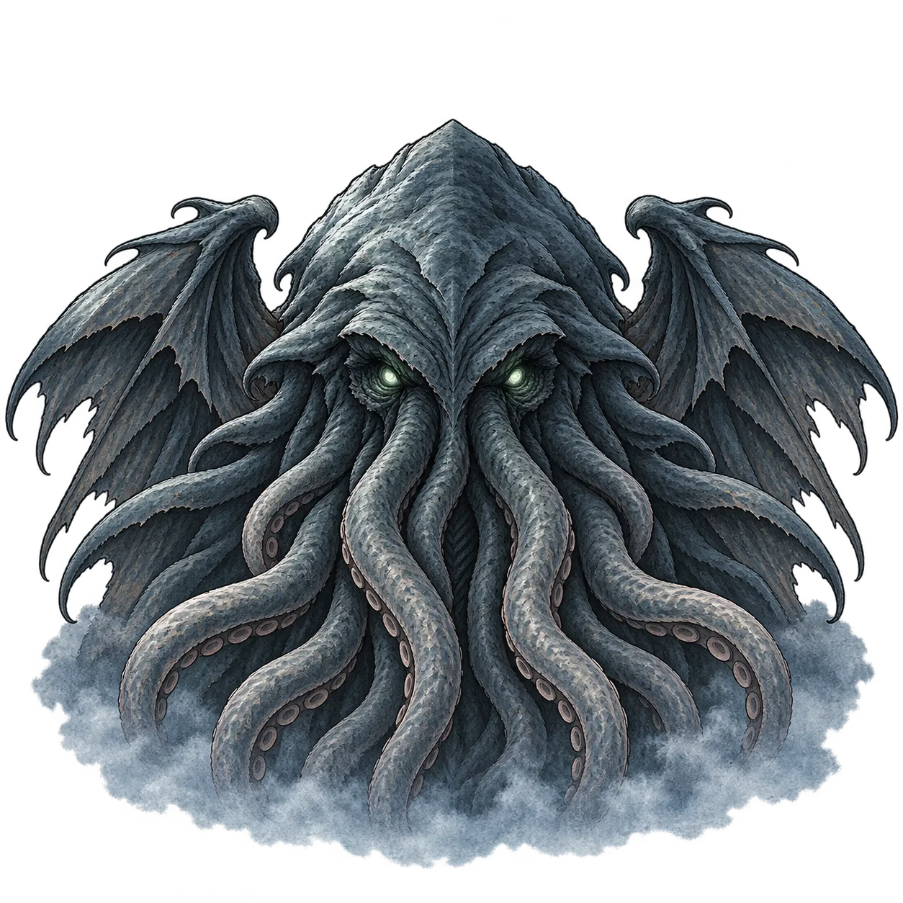

# 冥海契约 · Abyssal Contract

一款使用 **Godot 4.6** 制作的第一人称哥特恐怖钓鱼游戏原型。以魂为线，在冥海中垂钓；每逢黄昏向雾中的存在供奉，尝试偿清七夜的契约。

An open-source first-person gothic horror fishing prototype built with Godot 4.6. Fish the Nether Sea, make offerings at dusk, and survive a seven-night contract.

> 当前发布的是开发中的完整可运行工程快照。玩法、美术和平衡仍会调整，暂时没有音频，尚非正式成品。



## 运行工程

1. 安装 Godot **4.6.3 Standard**（GDScript 版本，无需 .NET）。
2. 下载本仓库 ZIP 并解压，或执行：

   ```sh
   git clone https://github.com/LohmingIDesgin/abyssal-contract.git
   ```

3. 在 Godot 项目管理器中导入根目录的 `project.godot`。
4. 等待首次资源导入完成，按 **F6** 运行当前场景或 **F5** 运行整个项目。

主场景为 `scenes/main/prototype_main.tscn`。工程使用 Forward+ 渲染，请使用支持该渲染器的显卡和驱动。首次导入 `.glb` 和贴图会比后续启动更慢。

中文优先使用系统中的 Noto Serif SC / 思源宋体，Windows 可回退宋体。其他系统若中文显示不完整，请安装中文字体。英文手写字体 Caveat 已随工程提供。

运行游戏不需要 Python、Blender 或联网；部分美术的重新生成工具需要额外依赖。

## 基本操作

| 操作 | 按键 |
| --- | --- |
| 抛竿、咬钩时提竿、按住收线 | 空格 / 水面鼠标左键 |
| 搏斗中松线 | 松开空格 / 鼠标左键 |
| 剪线 | X |
| 制饵 | E |
| 查看契约与船舱 | Tab |
| 唤祂、进入黄昏供奉 | F |
| 图鉴 | C |
| 转头 | 移动鼠标 / A、D |
| 释放鼠标 | 按住 Alt，或打开界面 |

签约、供奉、奖励和渔获界面的快捷键以屏幕提示为准。

## 当前内容

- 抛竿、真假咬钩、提竿窗口、张力与体力搏斗。
- 多种冥海生物、成长阶段、特殊词条、动态渔获立绘与图鉴。
- 留下、生吞、处理渔获，利用材料制作饵料。
- 契约、供奉、烙印、恩赐构筑和海上事件。
- 夜海着色器、雾中巨物、雨、船体运动、第一人称手臂与鱼竿。

## 目录

| 路径 | 内容 |
| --- | --- |
| `scenes/` | 游戏场景 |
| `scripts/core/` | 钓鱼、契约、供奉、饵料、事件等规则 |
| `scripts/data/`、`data/` | 数据类型和配置 |
| `scripts/ui/`、`scripts/fp/` | 界面、海面和第一人称表现 |
| `assets/`、`shaders/` | 游戏使用的资源和着色器 |
| `tests/` | 规则测试、模拟器和演示工具 |
| `tools/` | 美术制作与日志分析工具 |
| `docs/` | 玩法和实现文档 |

此开源快照包含运行所需资源；不包含编辑器缓存、个人设置、试玩存档、录屏、临时上传回执、高精度美术工作原件和本地迭代历史。美术参考图与调试截图也未纳入发布包。

## 测试与导出

规则自检示例（将 `godot` 替换为本机可执行文件路径）：

```sh
godot --headless --path . res://tests/test_fishing.tscn
godot --headless --path . res://tests/test_contract.tscn
godot --headless --path . res://tests/test_bait.tscn
```

Godot 导出菜单中已有 Windows 试玩版预设。先安装与编辑器版本一致的导出模板，再选择自己的导出目录；无需提交导出密钥或本地配置。存档和试玩日志写入 Godot 的 `user://` 目录，不写进仓库。

## 许可与资源说明

本项目以 [MIT License](LICENSE) 发布，第三方材料保留其原许可。Caveat 字体采用 SIL Open Font License 1.1，全文随字体提供。资源说明见 [THIRD_PARTY_NOTICES.md](THIRD_PARTY_NOTICES.md)。

欢迎通过 Issue 提交可复现的问题，通过 Pull Request 改进玩法、代码、文档与资源。涉及配音或整体音色的改动，建议先附一小段试听。
